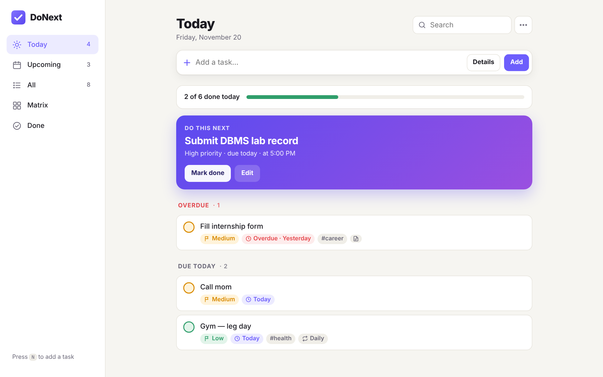
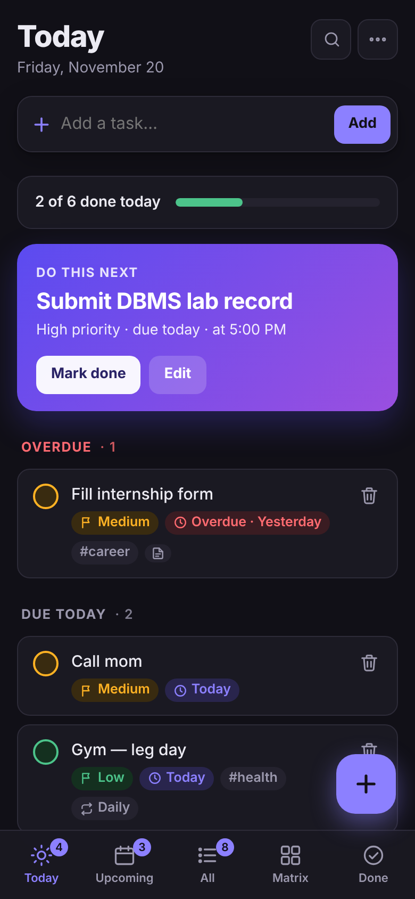

<div align="center">


# DoNext

**A priority-first to-do app that tells you what to do next.**
Works on phone, tablet and laptop, installs like a normal app, and runs fully offline.

**[▶ Open the app](https://om-sharma31.github.io/donext/)**

</div>

<p align="center">
  
  &nbsp;
  
</p>

---

## Features

- **"Do this next" card**: DoNext ranks every open task by priority and due date and shows the one to do now.
- **Today view**: overdue items, today's tasks and a progress bar for the day.
- **Upcoming view**: future tasks grouped by day, plus a "No date" list.
- **Priority matrix**: an Eisenhower view (Do first / Schedule / Quick wins / Later).
- **Quick add shortcuts**: type `Submit report !h #college @tomorrow` and the priority, tag and date are filled in for you.
- **Repeating tasks**: daily, weekly or monthly. When you tick one off, the next one is created.
- **Tags, search and notes** on any task.
- **Undo** for completing, deleting and clearing tasks.
- **Light and dark mode**: follows your system setting, or you can pick one.
- **Works offline and installs** on Android, iPhone/iPad, Windows, macOS, Linux and ChromeOS.
- **Private**: no account and no server. Your tasks never leave your device.
- **Backup and restore** to a `.json` file, which is also how you move tasks between devices.

## Install it on your device

Open **https://om-sharma31.github.io/donext/**, then:

| Device | How to install |
|---|---|
| **Android** (Chrome) | Tap **⋮** → **Add to Home screen** / **Install app** |
| **iPhone / iPad** (Safari) | Tap **Share** → **Add to Home Screen** |
| **Windows / Mac / Linux** (Chrome or Edge) | Click the **install icon** in the address bar, or **⋯** menu → **Install DoNext** |

After that it opens in its own window like any other app and works without internet.

## How the prioritising works

Each open task gets a score:

```
score = priority weight × 2 + urgency

priority weight:  High = 3, Medium = 2, Low = 1
urgency:          overdue = 5, today = 4, tomorrow = 3, within 3 days = 2, within a week = 1, later or no date = 0
```

The task with the highest score goes in the "Do this next" card, and every list is sorted the same way. As a result, a **High** task due today (score 10) comes before a **Medium** task that's a day overdue (9), and that comes before a **Low** task due today (6).

The **matrix** counts High and Medium as *important*, and anything overdue or due by tomorrow as *urgent*.

## Quick-add shortcuts

| Type | Meaning |
|---|---|
| `!h` `!m` `!l` | High / Medium / Low priority (default is Medium) |
| `#college` | Tag |
| `@today` `@tomorrow` `@mon` … `@sun` `@week` | Due date |

Keyboard: **N** adds a task, **/** searches, **Esc** closes the dialog.

## Using it on more than one device

Tasks are saved **in the browser on each device** (localStorage), so there's no sign-up and nothing is uploaded. To copy your tasks to another device, use **⋯ → Export backup** on the first device and **⋯ → Import backup** on the other. Imports are merged, so nothing gets overwritten by accident.

## Run it locally

You don't need to install or build anything, because it's plain HTML, CSS and JavaScript.

```bash
git clone https://github.com/Om-sharma31/donext.git
cd donext
python -m http.server 8000
```

Then open http://localhost:8000. You can also double-click `index.html`, but offline mode and installing only work when the app is served over `http(s)`.

## Project structure

```
donext/
├── index.html            # Page layout and the add/edit dialog
├── styles.css            # All styling, responsive layout, light/dark themes
├── app.js                # App logic: storage, prioritising, views, quick-add parser
├── sw.js                 # Service worker for offline support
├── manifest.webmanifest  # Makes it installable (name, icons, colours)
├── icons/                # App icons
└── screenshots/          # Images used in this README
```

## Tech

Vanilla JavaScript (no frameworks, no build step), CSS custom properties for theming, `localStorage` for data, and a Service Worker plus Web App Manifest to make it a **Progressive Web App (PWA)**. It's hosted for free on **GitHub Pages**.

## Roadmap

- [ ] Reminders/notifications for timed tasks
- [ ] Sub-tasks / checklists inside a task
- [ ] Drag to reorder
- [ ] Optional cloud sync between devices

## Author

**Anish Verma** · [@Om-sharma31](https://github.com/Om-sharma31)
B.Tech Data Science, Rungta University

## License

[MIT](LICENSE): free to use, change and share.
